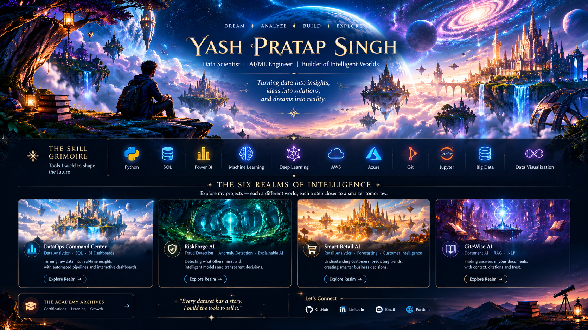

# Yash Pratap Singh

**Aspiring Data Scientist · AI/ML Engineer · Data Analytics Developer**

Python · SQL · Machine Learning · NLP · Dashboards

[Projects](#-the-realms-of-intelligence) · [Skills](#-the-skill-grimoire) · [Learning](#-the-academy-archives) · [Portfolio](https://exquisite-moonbeam-615c25.netlify.app/) · [LinkedIn](https://www.linkedin.com/in/yash-singh-/)

---

## ✦ Welcome to the Celestial Multiverse

Every dataset holds a hidden story. Every model opens a new possibility. I work where data, intelligence and creativity meet, building tools that turn complex information into useful discoveries.

I'm interested in analytics, predictive modeling, machine learning, NLP and intelligent applications, and I like presenting results visually.

> *Dream · Analyze · Build · Explore*

---

## ✧ The Skill Grimoire

| Realm | Tools |
|---|---|
| **Languages** | Python · SQL · Java · C++ |
| **Data & Analytics** | Pandas · NumPy · EDA · Statistics · Data cleaning · Data visualization |
| **Machine Learning** | Scikit-learn · Regression · Classification · Clustering · Feature engineering · Model evaluation |
| **NLP** | TF-IDF · Text classification |
| **Apps & Backend** | Flask · FastAPI · REST APIs · HTML/CSS/JavaScript · React |
| **Data & Cloud** | MongoDB · Firebase · AWS fundamentals |
| **Tools** | Git · GitHub · Jupyter |

<!--
UNCOMMENT ONLY IF YOU CAN DEFEND THEM IN AN INTERVIEW (not on your current profile):
Power BI · DAX · Excel · Docker · Embeddings · RAG · LLM applications
-->

---

## ✧ The Realms of Intelligence

Each project is a "realm". Click through to the code.

| Realm | Project | What it explores | Code |
|---|---|---|---|
| 🏰 **The Celestial Citadel** | DataOps Command Center | Data cleaning, validation, SQL, KPI dashboards | [Find repo](https://github.com/Yash28020?tab=repositories&q=DataOps) |
| 🌲 **The Shadow Realm** | RiskForge AI | Fraud detection, anomaly detection, explainability | [Find repo](https://github.com/Yash28020?tab=repositories&q=RiskForge) |
| 🛍️ **The Merchant Kingdom** | Smart Retail AI | Retail transactions to customer and product insights | [Find repo](https://github.com/Yash28020?tab=repositories&q=Retail) |
| 📚 **The Infinite Library** | CiteWise AI | Document retrieval and grounded answers (NLP) | [Find repo](https://github.com/Yash28020?tab=repositories&q=CiteWise) |
| 🔭 **The Oracle Observatory** | OmniMind AI Platform | Analytics pipeline, KPIs, forecasting | [Find repo](https://github.com/Yash28020?tab=repositories&q=OmniMind) |
| 🏆 **The Realm of Champions** | AI Fake News Detector · AQI Prediction | Text classification (TF-IDF) · environmental forecasting | [Fake News](https://github.com/Yash28020?tab=repositories&q=fake) · [AQI](https://github.com/Yash28020?tab=repositories&q=AQI) |

<!--
TODO before publishing:
1. Replace each "Find repo" link with the exact repository URL (https://github.com/Yash28020/<repo-name>).
2. Add a one-line, *verified* description per project from its own README.
3. Add "Live demo" links ONLY after opening them and confirming they load.

CLAIMS FROM YOUR PREVIOUS README, REMOVED UNTIL YOU CAN REPRODUCE THEM:
- OmniMind: 100K+ records, 92%+ forecasting accuracy, 70% less manual analysis
- Fake News Detector: 96% accuracy, 18% fewer false positives
- Smart Retail: 90%+ accuracy, 30% less ETL time
- AQI: 92% accuracy, 6.3% false positives, 24x7 live updates
Re-add each with dataset, split, metric and a notebook/script that reproduces it.
-->

---

## ✧ Artifacts of Creation

Evidence from running projects will live here: dashboard screenshots, evaluation plots (confusion matrix, precision-recall), SQL examples and architecture diagrams.

*Status: screenshots and metrics are being collected from the real projects. Nothing here is mocked.*

---

## ✧ The Academy Archives

**Completed**
- Oracle AI Foundations Associate: Oracle
- AWS Cloud Practitioner Essentials: AWS
- Cloud Computing: IIT Kharagpur (NPTEL)

**Virtual experience**
- Data Analytics Job Simulation: Deloitte

**In progress / practice**
- Microsoft Azure AI Fundamentals: preparation
- LeetCode: problem-solving practice

<!-- Add verification links next to each credential when you have them. Confirm the Azure status: move it to "Completed" only if you hold the certificate. -->

---

## ✧ Currently Exploring

Generative AI and RAG · AI agents · Advanced ML and predictive analytics · NLP · Data engineering fundamentals · 3D and interactive data visualization

---

## ✧ Contribution Galaxy

See my real activity on the [GitHub contribution graph](https://github.com/Yash28020).

---

## ✧ The Final Portal

- **GitHub:** [Yash28020](https://github.com/Yash28020)
- **Portfolio:** [exquisite-moonbeam-615c25.netlify.app](https://exquisite-moonbeam-615c25.netlify.app/)
- **LinkedIn:** [yash-singh-](https://www.linkedin.com/in/yash-singh-/)
<!-- Email: add `- **Email:** [you@example.com](mailto:you@example.com)` once you choose a public address. -->

*"Every dataset has a story. I build the tools to tell it."*

